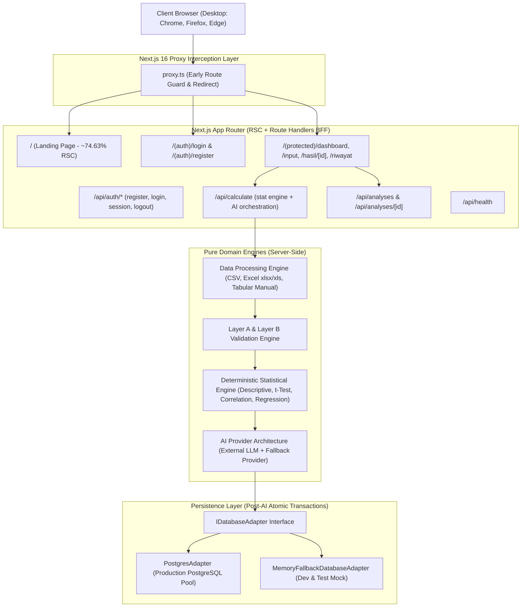

# Final System Architecture — Statistics Story AI

Dokumen ini mendokumentasikan arsitektur final aplikasi Statistics Story AI hasil migrasi dan implementasi menyeluruh dari baseline Vite SPA menjadi Next.js 16.x App Router production-grade.

---

## 1. High-Level Architectural Diagram

---

## 2. Core Architectural Pillars

### 2.1 React Server Components (RSC) vs Client Boundaries
- **Audited RSC Usage:** **74.63%** (50 Server Component modules, 17 Client Boundary modules, 67 total audited component files).
- **Measurement Tool:** `scripts/audit-rsc.ts` — automated source-based React Server Component boundary audit. Script membaca file `.tsx`/`.jsx`, mendeteksi keberadaan directive `'use client'`, dan mengklasifikasikan modul sebagai Server Component atau Client Boundary. Ini adalah engineering measurement terhadap source code boundary, bukan internal Next.js bundle metric atau analisis ukuran KB client bundle.
- **Audit Artifact:** `docs/rsc-audit.json` (hasil eksekusi otomatis, bukan hand-edited).
- **Server Component Responsibilities:**
  - Page definitions (`app/**/page.tsx`)
  - Shared layouts (`app/layout.tsx`, `app/(protected)/layout.tsx`)
  - Editorial landing page narrative scenes (`src/components/scenes/*`)
  - Server-side data fetching and metadata generation
- **Client Component Boundaries (`'use client'`):**
  - Form input and validation (`src/components/analysis-input/analysis-input-form.tsx`)
  - Drag-and-drop file upload (`src/components/app/file-dropzone.tsx`)
  - Client state management (`Zustand` UI store)
  - Remote data caching & mutation (`TanStack Query v5`)
  - Interactive SVG visualizations and tabs (`src/components/analysis-result/*`)

### 2.2 Route Protection & BFF Security Model
- **Next.js 16 Proxy Convention (`proxy.ts`):** Evaluates HTTP cookies early in the request pipeline and redirects unauthenticated access to `/login?from=...`.
- **Deep Server Authorization:** Every API Route Handler (`/api/calculate`, `/api/analyses/*`, `/api/hasil`) verifies the cryptographically signed HMAC-SHA256 session token using `getSessionFromRequest(request)`. The client is **never trusted** with arbitrary `userId` or `id_pengguna`.
- **User-Scoped Data Boundary (Anti-IDOR):** In `GET /api/hasil?id=...`, ownership is strictly filtered at the database level (`WHERE id_analisis = $1 AND id_pengguna = $2`). Unauthorized access returns HTTP 404.
- **Post-AI Atomic Transaction:** External AI provider HTTP calls are executed strictly *prior* to opening database transactions. Once AI results are validated with Zod, an atomic transaction inserts records into the 7 relational entities in exact foreign-key sequence.

### 2.3 Canonical Result Contract & Type-Safe Normalization
- **Single Source of Truth:** `src/lib/validation.ts` defines `visualizationDataSchema` as a strict Zod discriminated union based on `kind`:
  - `histogram`: `values: number[]`, `bins?: HistogramBin[]`
  - `bar`: `groups: { groupName: string, mean: number, sd?: number, n?: number }[]`
  - `scatter`: `points: { x: number, y: number }[]`, `trendline?: { slope, intercept, rSquared }`
- **Zero Type Escapes:** No `z.any()`, no `Record<string, any>`, and no `as any` casts in the result processing pipeline.
- **Normalizer Adapter (`src/lib/result/normalizers.ts`):** Adapts PostgreSQL relational rows (`visualisasi.data_grafik`, `hasil_statistik.nilai_statistik`) into canonical domain models before sending to the client. If validation fails, the API responds with HTTP 500 without leaking database internals.

### 2.4 FR15 Continuous Single-Page Result Presentation
- Legacy tab-based concealment (`HasilDetailTabs`) has been completely removed from the production codebase.
- The production view (`HasilQueryView`) presents all four required outputs continuously:
  1. **Angka Statistik** (`ResultSummary` & `StatisticsGrid`)
  2. **Narasi Interpretasi AI** (`NarrativeCard` with transparent AI vs Fallback badge)
  3. **Visualisasi Grafik** (`VisualizationPanel` with actual data and zero fake fallbacks)
  4. **Contoh Kasus & Analogi Nyata** (`ExampleCaseCard`)
  All sections are rendered simultaneously in the DOM tree, accessible via scroll and sticky anchor navigation (`#ringkasan`, `#statistik`, `#narasi`, `#visualisasi`, `#contoh-kasus`).

---

## 3. Technology Stack Summary

| Layer | Technology | Version | Purpose |
|---|---|---|---|
| **Framework** | Next.js (App Router) | 16.3.5 | Production Server Application & BFF |
| **UI Library** | React | 19.0.0 | Component rendering & Server Components |
| **Styling** | Tailwind CSS | v4.3.3 | High-performance CSS engine |
| **Primitives** | Radix UI (`@radix-ui/*`) | Latest | Accessible UI components (replaces `@base-ui/react`) |
| **Variant Styling** | Class Variance Authority (CVA) | 0.7.1 | Component variants management |
| **Client UI State** | Zustand | 5.0.15 | Ephemeral UI states (sidebar, modals, filters) |
| **Remote Server State**| TanStack Query | 5.102.8 | Server state caching, invalidation, mutation |
| **Database** | PostgreSQL (`pg`) | 8.13.3 | Relational database production persistence |
| **Tooling & Linter** | Biome | 2.5.13 | High-speed linting, formatting, import sorting |
| **Test Runner** | Vitest | 3.2.7 | Unit, domain, and API integration testing |
| **Test Coverage** | v8 | 3.2.7 | Statements: 86.32%, Lines: 86.32%, Branches: 71.37%, Functions: 90.21% |
| **Static Analysis** | SonarQube | Cloud/Server | Quality gate, security hotspots, duplication |

